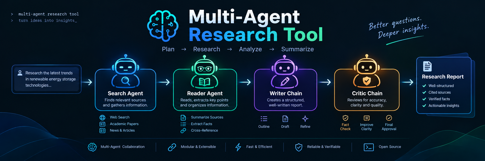

# Multi-Agent Research System

A full-stack, multi-agent research pipeline. Search the web, scrape sources, draft a report, and critique it.

```
Multi-Agent Research System/
├── backend/              # FastAPI backend
│   ├── main.py           # FastAPI app + routes
│   ├── research_stream.py# SSE research pipeline wrapper
│   ├── models.py         # Pydantic models
│   ├── requirements.txt  # Python dependencies
│   └── .env              # API keys (GROQ_API_KEY, TAVILY_API_KEY)
├── frontend/             # React + Vite frontend
│   ├── src/
│   │   ├── App.jsx       # Main application
│   │   ├── hooks/        # useTheme, useResearch
│   │   └── components/   # UI components
│   └── package.json
├── agents.py             # Existing agent logic (LangGraph + LCEL)
├── tools.py              # Existing Tavily search + BeautifulSoup scraping
├── pipeline.py           # Existing research pipeline entry point
├── requirements.txt      # Python dependencies (root)
├── .env                  # API keys (root)
└── .gitignore
```

---

## Quick Start

### Prerequisites

- Python 3.10+ with `venv`
- Node.js 18+ with npm
- Groq API key (https://console.groq.com/)
- Tavily API key (https://app.tavily.com/)

### 1. Backend

```bash
cd "/home/aditya/Desktop/Multi-Agent Research System"

# Create/activate venv (if not already done)
python3 -m venv venv
source venv/bin/activate

# Install backend dependencies
pip install -r backend/requirements.txt

# Configure environment
cp backend/.env.example backend/.env
# Edit backend/.env and add your GROQ_API_KEY and TAVILY_API_KEY

# Start the backend
cd backend
uvicorn main:app --reload --port 8000
```

Backend runs at: `http://127.0.0.1:8000`

Verify:
```bash
curl http://127.0.0.1:8000/api/health
# → {"status":"ok"}
```

### 2. Frontend

```bash
cd "/home/aditya/Desktop/Multi-Agent Research System/frontend"

# Install dependencies
npm install

# Start the dev server
npm run dev
```

Frontend runs at: `http://localhost:5173`

It proxies `/api` requests to `http://127.0.0.1:8000` automatically.

### 3. Use the app

Open `http://localhost:5173`, enter a research topic, and watch the agents work in real time.

---

## API Reference

### `GET /api/health`
Health check. Returns `{"status": "ok"}`.

### `POST /api/research`
Starts a research stream. Accepts JSON body `{"query": "string"}`.
Returns a `text/event-stream` (SSE) with these event types:

| Event | Description |
|-------|-------------|
| `step` | Agent/tool lifecycle (searching, scraping, writing, critiquing) |
| `source` | Discovered source (title, url, snippet, domain) |
| `token` | Partial LLM text (streamed from writer/critic chains) |
| `done` | Pipeline complete |
| `error` | Something went wrong |

---

## Tech Stack

**Backend:** FastAPI, Uvicorn, SSE Starlette, LangChain, LangGraph, Groq, Tavily, python-dotenv

**Frontend:** React 18, Vite, Lucide React, CSS Variables (dark/light themes)

**Existing logic (wrapped, not rewritten):** `agents.py`, `tools.py`, `pipeline.py`

---

## Design

- **Dark theme by default** with near-black teal surfaces and turquoise accent (`#20B8CD`)
- **Light theme** with warm off-white (`#FBFAF4`) and the same accent
- **CSS variables** for all colors — themes swap cleanly
- **SSE streaming** — real agent progress, no faked events
- **Responsive** — works on mobile and desktop
- **Accessible** — keyboard navigation, focus states, `prefers-reduced-motion` support

---

## License

MIT License. See `LICENSE`.
